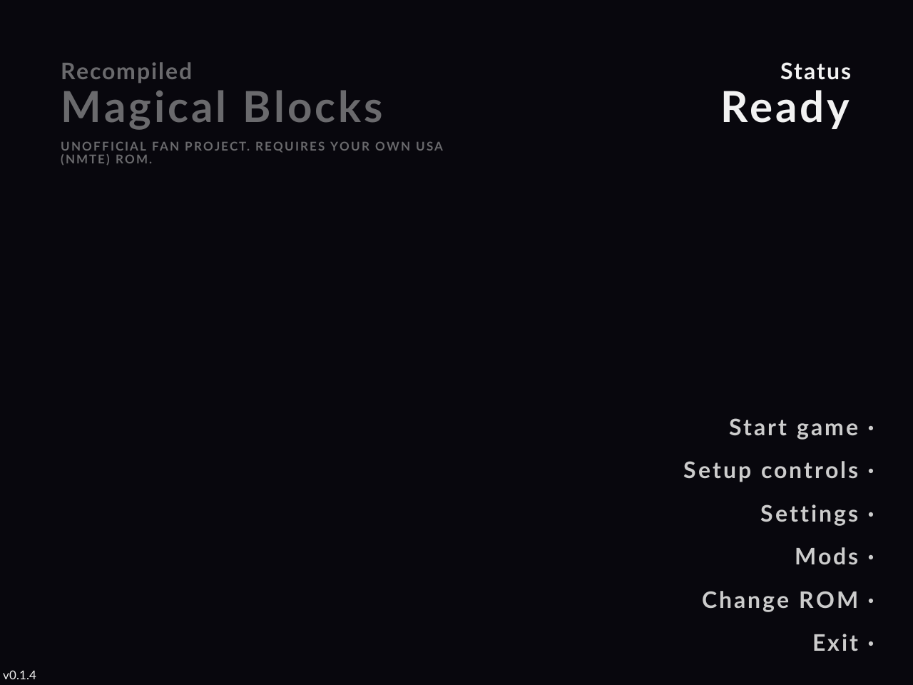
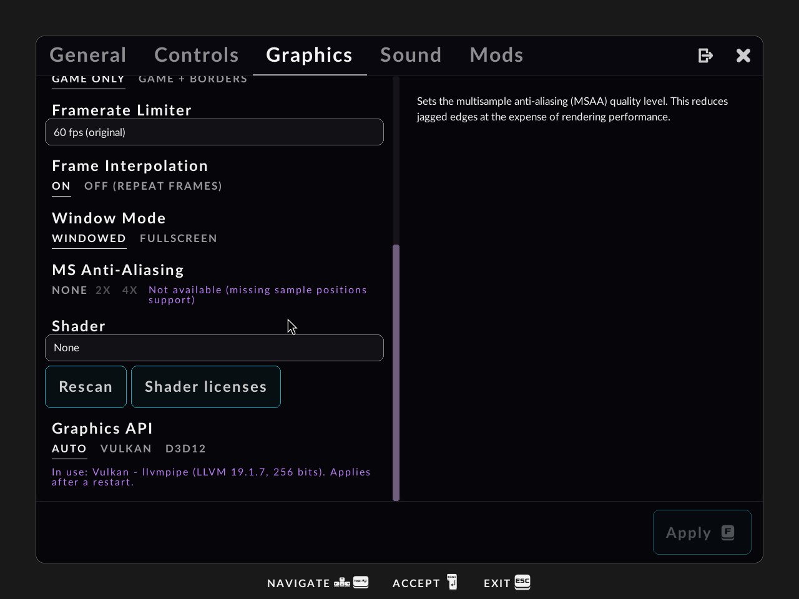

# Magical Blocks

An unofficial Windows PC port of an N64 puzzle game, made with [N64Recomp](https://github.com/N64Recomp/N64Recomp).

**Requires your own legally dumped Magical Tetris Challenge (USA) N64 ROM.** No game files are included.
The game is built on your own PC from your ROM the first time you start it (this takes a few seconds).

## How to install

1. Go to the [Releases](../../releases) page and download `MagicalBlocks-0.1.4-win64-setup.exe`.
2. Run it. (Windows may warn about an unknown publisher: click **More info**, then **Run anyway**.)
3. When the installer asks for your ROM, pick your own ROM file, dumped from your own cartridge.
   The installer checks it and prepares the game. This takes a few seconds.
4. Start **Magical Blocks** from the Start menu or the desktop shortcut.

Only the USA version of the game works. If your file is the wrong version, a hack, or a bad dump,
the game tells you so.

### Portable version (no installer)

Download `MagicalBlocks-0.1.4-win64-portable.zip` instead, unzip it anywhere and run `MagicalBlocks.exe`.
It asks for your ROM the first time. Settings, saves and logs are kept in the same folder.

## Shaders

Retro shaders (CRT and others) are included. Choose one in **Settings → Graphics → Shader**.

If you have extra `.slangp` / `.slang` shader files, put them (or a `shaders` folder) next to the setup file
before you run it, and the installer copies them in too.

## Controls

Keyboard and controllers both work. Change them in **Settings → Controls**.
In the settings menu, use LB / RB on a controller to switch tabs.

## Troubleshooting

* **Black screen, crash at start, or graphics problems:** open **Settings → Graphics → Graphics API** and
  try **Vulkan** or **D3D12**, then restart the game. Updating your graphics driver also helps.
* **"Not the supported version":** your ROM is not the USA version, or it is modified or a bad dump.
* **The game moved from an older version:** your settings and saves from older versions are copied over
  automatically the first time you start it.

## Logs, crash reports and reporting a bug

* Installed version: press **Win + R**, type `%LOCALAPPDATA%\MagicalBlocks\logs` and press Enter.
* Portable version: the `logs` folder next to `MagicalBlocks.exe`.

`latest.log` is the log of the last session. If the game crashes, it shows a message with the path
of the crash report (`crash-....txt`).

To report a bug, open an [issue](../../issues) and say what you did and what happened.
Attach `latest.log` and any `crash-....txt` file. **Please never attach or link a ROM.**

## Legal

* This project does not include any game files, game code, or ROM. You must own the original game and
  use your own dumped ROM.
* This is an unofficial fan project. It is not affiliated with, endorsed by, or connected to Nintendo,
  Capcom, Disney, or The Tetris Company. All trademarks belong to their owners.
* The source code of this project is licensed under the GPL version 3 (see [LICENSE](LICENSE)).

## Credits and licenses

* [N64Recomp](https://github.com/N64Recomp/N64Recomp) by Wiseguy and contributors (MIT)
* [N64ModernRuntime](https://github.com/N64Recomp/N64ModernRuntime) (librecomp and ultramodern) (MIT)
* [RT64](https://github.com/rt64/rt64) renderer by Darío and contributors (MIT)
* [RmlUi](https://github.com/mikke89/RmlUi) user interface library (MIT)
* Project layout based on [Zelda64Recomp](https://github.com/Zelda64Recomp/Zelda64Recomp) (GPL-3.0)
* Shaders from [libretro slang-shaders](https://github.com/libretro/slang-shaders) (each shader keeps its own license, see `shaders/LICENSES` in the installed game)
* Fonts: Lato, Noto Emoji and PromptFont (SIL Open Font License, see `licenses/`)
* [LLVM / clang](https://llvm.org/) (Apache-2.0 with LLVM exception), used on your PC to build the game code
* [SDL2](https://www.libsdl.org/) (zlib)

The full list is in `THIRD-PARTY-NOTICES.txt` in the installed game.

## Building from source

See [BUILDING.md](BUILDING.md).
